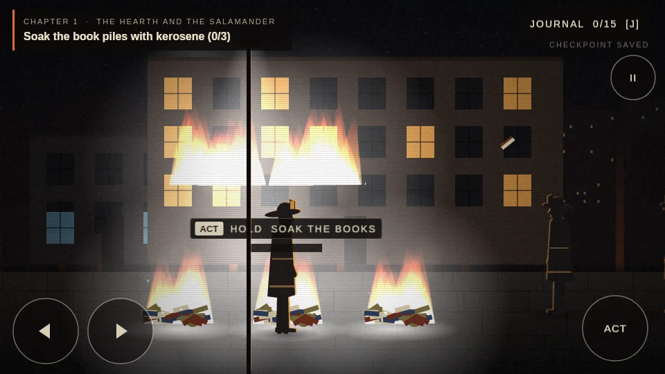
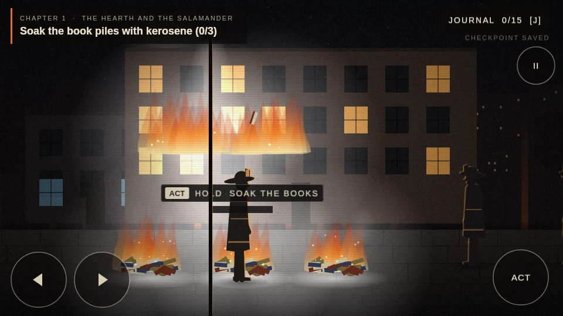
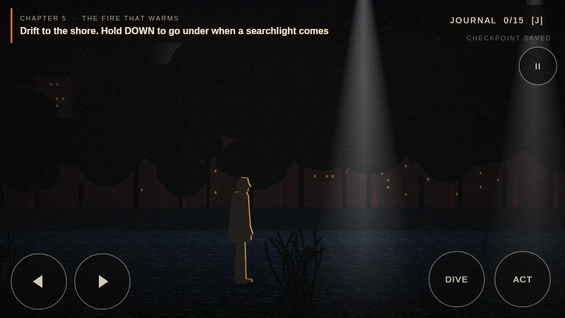
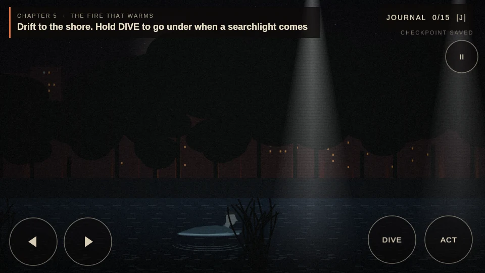

# Work development and QA report

Audit date: November 9, 2026, America/Phoenix. Deadline: Friday, November 13. This report describes verified development progress, not school-project completion.

## A. Starting condition

Repository: `hewwobuddy2023-dev/fahrenheit451-game`. Remote `feat/m2-chapters` matched `94c45a3d38a1ec3c562631bd33fe851357a47eee`; `main` was `7861c3b`, earlier documentation. M1 tag `m1-complete` remained intact (annotated tag, target `55e0989`). No existing Work branch existed. The scratch checkout was clean before Work created `work/overnight-mobile-qa`.

Inherited 7 tests, TypeScript and production build passed independently. Chapters 1–4 were previously reported as browser-tested by Claude; Chapter 5/endings were inherited as untested. Owner reported an iPhone on which nothing could be tapped. Work found additional concrete defects during review and simulation.

## B. Implemented changes and files

| Area | Files | Change and reason |
|---|---|---|
| Input / touch layout | `src/ui/MenuList.ts`, `Hud.ts`, `Dialogue.ts`, `Journal.ts`, `src/scenes/RoomScene.ts` | Explicitly fixed interactive scroll factors; whole-row targets; wrapped choices; DIVE; pointer-owned holds and cancellation; Hound quick-tap latch; larger/wrapped objectives and mobile wording. |
| Viewport | `index.html` | Dynamic viewport wrapper, inset safe-area parent, canvas touch rules. Phaser measures border-box bounds, so padding on its parent would distort fit. |
| Saves | `src/state.ts`, `src/checkpoints.ts`, `MenuScene.ts`, `RoomScene.ts` | Catch blocked storage getter, save full events atomically, recover six legacy interrupted transitions, validate room names, resume completed endings, confirm before New Game replaces progress. |
| Campaign stability | `RoomScene.ts` | Clear destroyed spray reference on restart; freeze stillness waits behind pause/journal and avoid spawning movement notices every frame. |
| Art / download | `src/art/fx.ts`, `figures.ts`, `src/main.ts`, `MenuScene.ts` | Padded smooth fire cells, floating surface sprite/wake, correct shore return/shadow, Latin-only font CSS, remove nonexistent title sky request. |
| Regression engineering | `tests/state.test.ts`, `simulation.mjs`, `campaign.mjs`, `regression.mjs`, `visual.mjs`, `tests/support/*`, `package*.json`, `.github/workflows/pages.yml` | Unit and actual Phaser DOM/Canvas integration coverage. Simulation suites run in PR CI. Test-only dependencies; no runtime package upgrades. |
| Continuity / school | `PROGRESS.md`, `TESTING.md`, `ART_DIRECTION.md`, `ASSET_MANIFEST.md`, `README.md`, `AGENTS.md`, `CLAUDE.md`, six school drafts, handoff and resume prompt | Correct stale preproduction status, document evidence and outstanding owner work. |

Source history is preserved. Changes are three implementation milestones followed by a documentation handoff. PR #1 targets M2; main and the live release were not replaced.

## C. Mobile diagnosis and evidence

**Reproduced root cause for scrolled in-game controls:** Phaser 3.90.0 `Container.setScrollFactor(0, 0, true)` calls `Utils.Array.SetAll`, which sets only own properties. Child hit targets still inheriting `scrollFactorX/Y = 1` are skipped. Rendering inherits the pinned container, while `InputManager.hitTest` uses the child’s own scroll factor. At camera scroll X about 280, a touch at the visible right button had no hit. Explicit `.setScrollFactor(0)` on each interactive child repairs that mismatch. The regression suite tests controls with a scrolled camera.

**Other verified source defects:** river diving required keyboard Down, with no touch equivalent; short Hound touches could start/end between polling frames; touch holds lacked robust cancellation; text-only menu targets were small. These now have concrete fixes and simulation coverage.

**Limit:** the original title menu responded to synthetic touch even before the fix. The owner’s claim that absolutely nothing responds on the real iPhone is not conclusively reproduced or explained. Do not mark the whole real-iPhone issue closed based on these results.

| Evidence type | Actual result |
|---|---|
| Source analysis | Phaser engine source and project input/save code inspected. |
| Synthetic touch | Native DOM touchstart/move/end/cancel events go through the actual bundled Phaser TouchManager, hit testing and scenes. Four viewport configurations pass. |
| Work build in Chromium | Not performed: local Chromium launch failed with socket permission denial; cloud Chrome could not access localhost. |
| Cloud Chrome, deployed baseline | Existing Pages title rendered with its fonts and reached the opening after a sequence of mouse and Enter actions at 1363×936. This does not isolate which action started it and does not test Work changes. Tool/browser throttling made the displayed FPS unsuitable for hardware benchmarking. |
| WebKit | Not performed: executable absent. |
| Real iPhone / Chromebook | Not performed. |
| Human playtesters | 0 recorded. |

Simulation uses jsdom 31, native Canvas 1.1, Node 24.22.1 in the isolated Linux workspace. It renders through Phaser’s Canvas fallback, uses fallback fonts, advances a deterministic clock and forces a nominal loop FPS. It does **not** reproduce Safari layout, native gesture dispatch, GPU/WebGL, or hardware performance. Test package esbuild 0.25.12 bundles the real application while omitting CSS imports. Production Vite build separately verifies the CSS/font assets.

## D. Campaign verification

Each row passed in one ordinary sequential simulated run starting New Game. The harness teleports between static hotspots; holds, interactions, dialogue, choices, retries and hazard crossings use actual game logic and synthetic inputs. It does not set completion flags. It reads content metadata to select valid answers. This verifies engine integration, not whether unassisted players understand the puzzles.

| Challenge | Chapter | Result and exercised behavior |
|---|---:|---|
| 01 The Burn | 1 | PASS — three touch holds, ignition response, transition; satisfaction-first opening preserved. |
| 02 Clarisse’s Question | 1 | PASS — meeting, three observation choices, question and home transition. |
| 03 Parlor Walls | 1 | PASS — all walls, three talks and script; journal 3/15. |
| 04 The Woman’s House | 2 | PASS — watched attempt blocked, look-away success, plea and fixed story outcome. |
| 05 Beatty’s Argument | 2 | PASS — wrong responses retry; argument proceeds. |
| 06 The Hidden Books | 2 | PASS — chair, held vent, Mildred, movement reset, six-second pause without hidden progression; journal 6/15. |
| 07 Find Faber | 3 | PASS — file, phone and departure. |
| 08 The Sieve and the Sand | 3 | PASS — wrong recall picks retry; subway transition. |
| 09 Dover Beach | 3 | PASS — switch, ladies, poem response and incinerator; journal 9/15. |
| 10 Montag’s House | 4 | PASS — beds/three walls, cinematic, missed Hound response then quick touch retry. |
| 11 The Boulevard | 4 | PASS — deliberate capture resets to kerb; touch movement and safe-gap waits cross lanes; Black choice. |
| 12 The Count of Ten | 4 | PASS — masking, deliberate timeout/reset, complete touch-driven escape; journal 12/15. |
| 13 The River | 5 | PASS — deliberate searchlight capture, two-finger movement/dive, shore and track; float changes to walk on land. |
| 14 The Book People | 5 | PASS — meeting, wrong recall/retry and offering; legitimate 14/15 checkpoint. |
| 15 The Fireman’s Choice | 5 | PASS — final choice, shared bombing, distinct epilogue and ending card; 15/15. |

Preservation completed the full sequential run. Defiance and Submission were each independently loaded from the genuine pre-ending checkpoint via Continue and completed to their own ending cards. All three remain available by design. Chapter 2/3/4/5 boundary saves reload through Continue. Completed ending Continue and return-to-title pass. Earlier-choice combinations are not exhaustively enumerated.

No critical campaign softlock remains known in these covered routes. A Chapter 2 crash was reproduced at the vent after the Chapter 1 hose: `spray` retained a destroyed emitter across scene restarts. Clearing it in `init` fixed the full-run failure.

## E. Visual work

Before visual polish (functional checkpoint `5d4a450`) and after:

| | Before | After |
|---|---|---|
| Flames |  |  |
| River |  |  |

These are labeled synthetic visual fixtures, not browser screenshots. The fire fixture invokes the existing ignition effect for visual comparison while its HUD retains fixture progress. No classroom evidence is fabricated. See `PERFORMANCE_AUDIT.md` for costs; swimming changes only presentation.

## F. Build and regression results

- `npm test`: **9/9 pass**, including blocked localStorage getter and legacy interrupted-checkpoint recovery.
- `npm run typecheck`: **pass**.
- `npm run build`: **pass**, with Vite’s existing large-chunk warning; no suppressed warning or runtime engine split.
- `npm run test:simulation`: **4 configurations pass** — 844×390, 667×375, 390×844, 1366×768 with lowres. New Game, dialogue, movement, journal and pause use synthetic touch.
- `npm run test:campaign`: **pass** — full 01–15, three endings, retries/hazards/stillness, chapter Continue, ending Continue/title.
- `npm run test:regression`: **pass** — invalid saves, blocked storage, all five Presentation starts/quits save-isolated, multitouch release/cancel, keyboard hold/blur, repeated keys, interrupted event rollback, restart confirmation and flame padding.
- `git diff --check`: **pass** at implementation checkpoints.
- PR CI `42749692291` passed initial mobile checkpoint; `42750416512` passed full campaign checkpoint. Final implementation CI `42751743738` at `46129d6` also **passed** all suites and build. The documentation-only head’s check is shown in PR checks; inspect it before review.

## G. Git and deployment

Work branch: `work/overnight-mobile-qa`. PR: https://github.com/hewwobuddy2023-dev/fahrenheit451-game/pull/1 (draft). Base remains `feat/m2-chapters` at `94c45a3` unless another developer advances it later. Implementation checkpoints: `4155f7e`, `5d4a450`, `46129d6`.

No force push, deletion, merge, hosting switch or Pages deployment was performed by Work. Shell Git had read access but no write credentials; approved connected GitHub operations created the commits and fast-forwarded only the Work branch. Local indexed trees were compared against the remote trees when synchronizing.

**Merge recommendation:** suitable for Claude code review, not unconditional approval. Require real browser/mobile verification, CI review and owner approval before integration. The existing workflow deploys pushes to M2 as well as main/M1; merging PR #1 into M2 can therefore trigger Pages deployment. Plan that explicitly.

## H–J. Remaining risks, handoff and readiness

Highest priority: run the Work branch in Chromium/WebKit, reproduce the reported phone failure on real Safari, check safe areas/rotation/toolbar changes and all touch paths. Test on the actual Chromebook over school Wi-Fi; measure demanding scenes and reduced resolution. Long-running hardware scenes and reduced-frame-rate fairness remain unmeasured.

Narrative event order and ending logic were preserved; only control hints changed. The story document says tearing Faber’s Bible shapes an ending detail, but `faber.tear` currently has no ending-specific branch. Existing other flags do affect framing/details. Claude should either implement a small approved detail or correct that claim; it does not block reaching endings.

School deliverables are drafts. Two real human playtests, three verified short quotations with matching printed pages, final word count, personal revision and a timed classroom rehearsal remain mandatory. The project is substantially stronger technically, but **not submission-ready**. November 13 remains feasible only if those device/citation/human checks are completed promptly.

Read `WORK_TO_CLAUDE_HANDOFF.md` and paste `CLAUDE_RESUME_PROMPT.md` into Claude Code on PC. No automatic five-hour restart or continued agent execution has been configured. The durable branch/PR is the manual continuation checkpoint.
